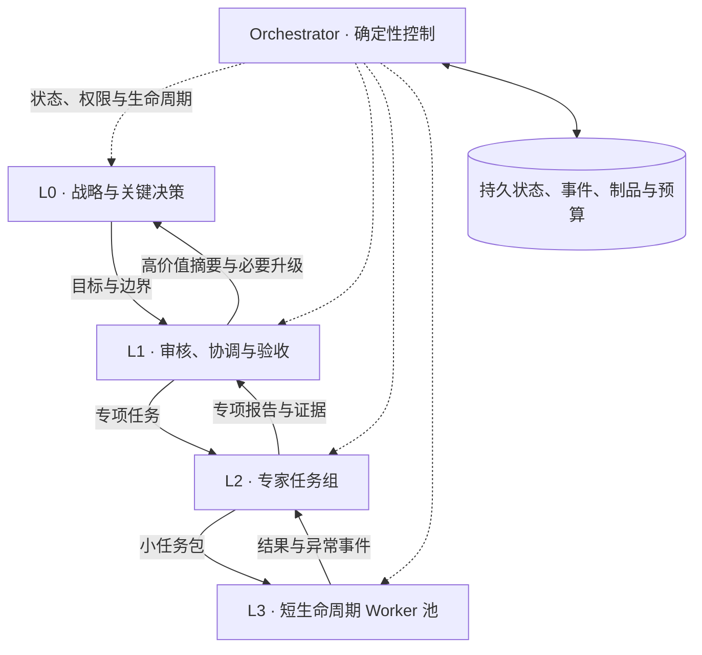
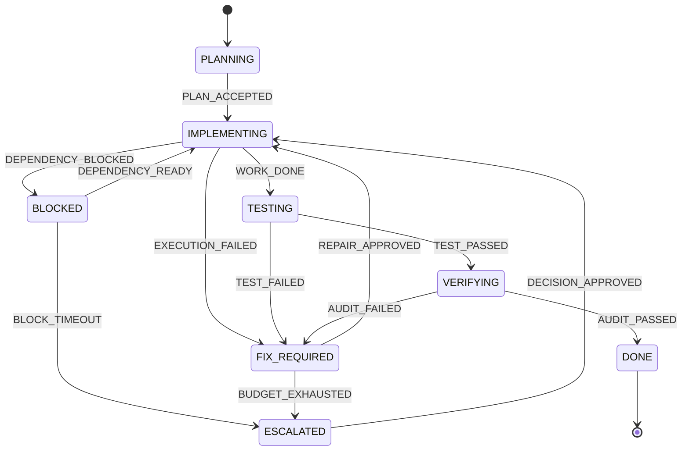

# Hierarchical Agent OS · 分层智能体操作系统

项目实施指南 · v0.1 · 2026-10-03

通过 L0 战略层、L1 审核协调层、L2 专家层和 L3 执行层，把长任务拆成有边界、可验证、可恢复的工作。任务向下派发，结果和异常逐级上行，确定性的 Orchestrator 负责真实状态、权限、预算与生命周期。

**实施目标：让最强模型集中处理高价值判断，让运行时保证任务推进有据可查、失败可恢复、成本有上限。**

本文约定：标为“当前”的内容已存在于仓库；标为“目标”“建议”“待实现”的内容是后端实施方案。示例数量、token 配额和时间参数是起始配置，需要通过实际任务评估调整。

## 1. 当前成果与使用方式

| 内容 | 当前状态 | 入口 |
| --- | --- | --- |
| 六章节架构动画 | 已完成；单文件 HTML/CSS/JS，时长 2 分 18 秒 | [打开动画](outputs/hierarchical-agent-os.html) |
| 动画预览图 | 已完成 | [查看预览](outputs/hierarchical-agent-os-preview.png) |
| 演示逻辑检查 | 已有脚本，覆盖状态转移、证据与权限守卫、事件去重、流转顺序和示例预算 | `work/check-demo.cjs` |
| 真实 Agent 后端 | 待实现 | 本文第 3–12 节 |

用桌面浏览器直接打开 HTML 即可播放，无需安装依赖或联网。支持暂停、重播、章节跳转、拖动进度、倍速、循环、录屏模式和全屏。

| 快捷键 | 功能 |
| --- | --- |
| `Space` | 播放 / 暂停 |
| `←` / `→` | 默认前后跳转 5 秒；进度条聚焦时按滑块步长调整 |
| `R` | 从头重播 |
| `L` | 循环播放 |
| `C` | 录屏模式；移动鼠标可唤回控制栏 |
| `F` | 全屏 / 退出全屏 |

如需通过本地地址预览，在项目根目录运行以下命令，需要本机已安装 Python：

```powershell
python -m http.server 8765 --bind 127.0.0.1 --directory outputs
```

然后访问 [本地预览](http://127.0.0.1:8765/hierarchical-agent-os.html)。结束预览时，在启动服务的终端按 `Ctrl+C`。

如已安装 Node.js，可在项目根目录运行现有演示检查：

```powershell
node work/check-demo.cjs
```

该检查只验证 HTML 中的演示逻辑，不能证明真实后端的并发、故障恢复或权限隔离已实现。当前页面没有调用真实模型，也没有数据库、消息队列或后台 Worker。

## 2. 架构原则与职责

### 2.1 四层认知结构

| 层级 | 核心职责 | 模型与生命周期 | 接收的信息 | 交付的结果 |
| --- | --- | --- | --- | --- |
| **L0 Strategic Agent** | 理解最终目标、制定战略、处理跨任务取舍与重大升级 | 默认最强模型；最长逻辑生命周期 | 最少且最高价值的摘要、关键风险、待决策选项 | 战略目标、边界、优先级、升级决策 |
| **L1 Auditor / Coordinator** | 审核、校对、聚合、核对验收标准、提出回归任务、必要时升级 L0 | 较强模型；覆盖一个任务或里程碑 | 专项报告、证据引用、异常与预算状态 | PASS / REVISE / BLOCKED / ESCALATE 结论及下一步建议 |
| **L2 Specialists** | 专项规划、细分任务、检查局部结果、整理专项报告 | 按专项选择模型；阶段生命周期 | 本专项目标、依赖、必要材料与验收约束 | 可执行任务包、专项证据与聚合结果 |
| **L3 Workers** | 完成边界明确的小任务并提交制品 | 默认较轻模型；短会话；数量最多、重建最频繁 | 最小任务包、受限工具与资源预算 | 制品引用、执行结果、失败或阻塞事件 |

默认方向为：**模型能力逐级降低，数量与重建频率逐级增加，生命周期逐级缩短。** 这是本项目的路由策略；遇到能力不足，应由策略允许升级，不能为了固定层级强行使用无法胜任的模型。动画中的 `1 → 1 → 3 → 9` 是拓扑示意，不是固定部署规模。

L0 的“长生命周期”指目标、身份和决策状态持续保存。L0 的模型会话同样可以结束、压缩或重建，无需永久占用一个超长上下文。

### 2.2 逻辑信息流



图中的层级箭头代表信息的逻辑去向。物理派发、事件接收和持久化统一经过运行时，Agent 无权绕过运行时直接创建进程、修改任务终态或扩大权限。不支持 Mermaid 的阅读器可直接参考上方职责表。

### 2.3 判断与执行的边界

| LLM 可以提出 | 运行时必须执行或校验 |
| --- | --- |
| 任务拆分、依赖关系与优先级 | 校验任务图无环、依赖存在，限制子任务数量与层级深度 |
| 完成、回归、等待或升级建议 | 校验结构、身份、任务代次、证据与合法状态转移 |
| 需要哪些工具、模型或材料 | 按授权策略授予范围，预留预算，再安排执行 |
| 失败原因、修复范围和恢复方案 | 控制重试次数、退避、超时、检查点和补偿动作 |

模型输出是带证据的提议。实际状态以持久化账本为准，不能从自然语言中的“完成了”推断任务已验收。

## 3. 首版实施范围与模块

### 3.1 建议的最小部署

首版采用 **一个服务端代码库 + 一个 Orchestrator 服务 + 一个隔离的 Worker 池 + PostgreSQL + 制品目录**。服务端默认可用 TypeScript，便于复用现有 JavaScript 演示中的契约；团队已有 Python 服务栈时也可沿用，事件契约保持一致。

先实现单项目、本地可恢复执行。初始配置为 1 个 L0 逻辑身份、1 个 L1 协调身份、最多 3 个 L2 专项和最多 6 个并发 L3 Worker。层级是角色，按需唤醒模型；不能把每个逻辑角色都实现为不断调用模型的常驻循环。

| 模块 | 实施内容 | 完成标准 |
| --- | --- | --- |
| Task API | 提交目标、查询状态、取消、暂停、恢复、提交升级决策 | 同一个提交幂等键只创建一个根任务 |
| Orchestrator | 纯状态转换函数、守卫、任务图、命令生成 | 相同状态与有效事件产生相同转换；不在转换函数中调用模型 |
| Agent Runner | 组装上下文、调用模型、校验结构化输出 | 运行中断后可从引用和检查点重建 |
| Model Gateway | 模型路由、超时、调用重试、用量归一化 | 所有调用均有调用 ID、模型记录、预算预留与用量结算 |
| Tool Gateway | 文件、测试、检索等工具；权限与副作用记录 | 工具执行范围受服务端策略限制，不能靠 prompt 自律 |
| Event Store / Outbox | 事件接收、去重、持久发布、重放 | 提交后服务崩溃仍可恢复待派发消息 |
| Aggregator / Auditor | 程序聚合事实，L1 审核语义和验收 | 对应制品版本的证据完整后才能通过 |
| Memory / Artifact Store | 原文、制品、摘要、决策、检查点与索引 | 重建会话后能够定位原始证据 |
| Supervisor / Scheduler | 租约、超时、并发、取消、重建、队列背压 | 失联 Worker 可被识别，旧实例不能覆盖新结果 |
| Observability | 任务树、事件时间线、调用成本和人工决策入口 | 能解释任务为什么等待、重试、升级或完成 |

PostgreSQL 保存权威状态；首版可使用数据库中的持久命令表作为工作队列。需要多消费者领取时，可使用短事务和 `FOR UPDATE SKIP LOCKED`；它适合队列式领取，不提供全局严格先后顺序，也不适合用于完整性验收查询。具体语义见 [PostgreSQL 锁定子句文档](https://www.postgresql.org/docs/current/sql-select.html#SQL-FOR-UPDATE-SHARE)。

调用模型或工具前必须提交领取事务，不能在等待外部响应时一直持有任务行锁。外部消息代理、向量检索和多机调度可在吞吐或检索需求得到验证后再引入。

### 3.2 建议目录结构

下面是目标结构，`src/`、`contracts/`、`tests/` 等目录尚待创建。现有 `work/` 保存演示制作和检查辅助文件。

```text
.
├── README.md
├── outputs/                    # 已有动画与预览图
├── work/                       # 已有演示检查和制作辅助文件
├── contracts/                  # Task、Event、Command、Audit JSON Schema
├── src/
│   ├── api/                    # 任务与人工决策接口
│   ├── orchestrator/           # reducer、守卫、调度、监督
│   ├── agents/                 # L0 / L1 / L2 / L3 的输入输出适配
│   ├── gateways/               # model、tool、policy
│   ├── events/                 # inbox、outbox、聚合、重放
│   ├── memory/                 # 检索、摘要、检查点
│   ├── storage/                # 数据库与制品存储
│   └── telemetry/              # 成本、指标、任务轨迹
├── policies/                   # 版本化权限、路由、预算与验收规则
├── migrations/                 # 数据库结构变更
├── tests/                      # 契约、集成、故障注入、评估集
└── docs/                       # 运行手册、接口规范、架构决策记录
```

## 4. 先固定任务、事件与审核契约

区分三个对象：**Task** 表示要完成的工作；**Event** 描述已发生的事实；**Command** 表示运行时批准后准备执行的动作。所有契约带 `schema_version`，升级时保持兼容或提供迁移处理。

### 4.1 Task Packet：传给 Worker 的最小任务包

```json
{
  "schema_version": 1,
  "run_id": "run-demo-001",
  "task_id": "task-api-003",
  "parent_task_id": "task-backend-001",
  "level": "L3",
  "role": "implementation_worker",
  "goal": "修复分页接口的空结果边界行为",
  "input_refs": [
    {"artifact_id": "source-api", "revision": "rev-7"},
    {"artifact_id": "acceptance-spec", "revision": "rev-2"}
  ],
  "acceptance_criteria": [
    {"id": "AC-01", "check": "空结果返回空数组且分页元数据一致", "evidence_kind": "test_report"},
    {"id": "AC-02", "check": "既有分页用例通过", "evidence_kind": "regression_report"}
  ],
  "depends_on": [],
  "allowed_tools": ["workspace.read", "workspace.write", "tests.run"],
  "workspace_scope": "workspaces/task-api-003",
  "budget": {
    "max_context_tokens": 12000,
    "max_output_tokens_per_call": 2000,
    "max_model_calls": 5,
    "max_attempts": 3,
    "max_rebuilds": 3,
    "timeout_seconds": 600
  },
  "policy_version": "policy-demo-v1"
}
```

服务端根据角色策略生成 `allowed_tools`，实际执行时再次核验；Worker 修改 JSON 不会获得新权限。`max_attempts: 3` 表示总共最多执行 3 次，包含首次执行；`max_rebuilds: 3` 另限制实例重建次数。`max_context_tokens` 在本契约中表示输入额度，与输出预留之和不得超过实际模型窗口。`max_model_calls` 包含重试产生的实际请求。

任务记录另存 `state`、`version`、当前 `attempt`、`generation`、父子依赖和检查点。一个根任务以 `run_id` 汇总预算，任何子任务都必须从父预算中取得额度。

### 4.2 Event Envelope：结果上行协议

```json
{
  "schema_version": 1,
  "event_id": "evt-demo-017",
  "run_id": "run-demo-001",
  "task_id": "task-api-003",
  "kind": "DONE",
  "source": {"agent_id": "worker-008", "level": "L3"},
  "attempt": 1,
  "generation": 4,
  "lease_id": "lease-demo-004",
  "source_seq": 7,
  "observed_task_version": 12,
  "causation_id": "cmd-execute-011",
  "payload": {
    "summary": "已生成修复制品与候选测试报告，等待独立测试及审核",
    "artifact_refs": [{"artifact_id": "patch-api", "revision": "rev-8"}],
    "evidence_refs": ["candidate-test-report-008"],
    "usage_ref": "usage-call-023"
  }
}
```

| 字段 / 约束 | 实施要求 |
| --- | --- |
| `event_id` | 全局去重键；重投使用原 ID；同 ID、不同内容按协议冲突处理 |
| `attempt` | 当前业务执行次数；修复并重新执行时递增 |
| `generation` | 执行实例的代次；每次重新分配执行所有权都递增，用来隔离迟到结果 |
| `lease_id` | 当前执行租约；由运行时签发，接收端核验 |
| `source_seq` | 同一任务、来源和代次内递增；不作为跨 Worker 的全局排序号 |
| `observed_task_version` | 生产者看到的版本；仅作上下文，接收端不能只凭版本较旧丢弃并行产生的有效事实 |
| `causation_id` | 指向引发本事件的命令或事件，便于恢复和解释因果 |
| 制品与证据引用 | 指向持久、版本确定的内容；接收方验证存在性、完整性和任务归属 |

运行时根据身份、租约、代次、阶段和制品版本判断事实是否仍适用，再通过锁或版本比较原子提交新状态。状态修改命令携带 `expected_task_version`；冲突后重读并重新判定。时间戳用于排查延迟，不能替代因果和版本校验。

事件类别至少覆盖 `DONE`、`FAILED`、`BLOCKED`、`ESCALATE`。**Worker 的 `DONE` 是一次执行结果事件，任务状态 `DONE` 是验收通过的终态。** 两者必须在代码命名、日志与界面中区分，例如使用 `worker.done` 和 `task.completed`。

### 4.3 L1 审核输出

```json
{
  "task_id": "task-api-003",
  "artifact_revision": "rev-8",
  "verdict": "REVISE",
  "criteria": [
    {"id": "AC-01", "result": "PASS", "evidence_refs": ["test-empty-008"]},
    {"id": "AC-02", "result": "FAIL", "evidence_refs": ["test-pagination-008"]}
  ],
  "reason": "空结果用例通过，但末页边界仍失败",
  "regression_scope": ["修复末页边界", "重新执行分页回归用例"],
  "escalation": null
}
```

允许的 `verdict` 为 `PASS / REVISE / BLOCKED / ESCALATE`。通过结论必须覆盖全部必选验收项，证据必须对应当前制品修订。可确定的测试、哈希和权限检查交给程序；L1 重点判断语义、完整性、风险与目标是否一致。保存结论、依据和决策理由即可。

## 5. Orchestrator 状态机与自动回归

### 5.1 主闭环



图展示核心路径。下面的转换表定义生产实现所需的守卫；租约回收、暂停和取消还要遵循第 6 节。

| 当前状态 | 触发事实 / 批准动作 | 下一状态 | 守卫与副作用 |
| --- | --- | --- | --- |
| PLANNING | PLAN_ACCEPTED | IMPLEMENTING | 目标和验收条件齐全；依赖图合法；权限与预算允许 |
| IMPLEMENTING | WORK_DONE | TESTING | 制品已持久化；来源及代次有效；所需执行结果已齐备 |
| IMPLEMENTING | EXECUTION_FAILED | FIX_REQUIRED | 记录分类后的失败与恢复依据，不吞掉错误 |
| TESTING | TEST_FAILED | FIX_REQUIRED | 保存失败报告，交 L1 界定回归范围 |
| FIX_REQUIRED | REPAIR_APPROVED | IMPLEMENTING | 有修复范围、剩余预算和有效授权；实际重执行前递增 attempt |
| FIX_REQUIRED | BUDGET_EXHAUSTED | ESCALATED | 预算确已耗尽；冻结自动执行并上送选择项 |
| TESTING | TEST_PASSED | VERIFYING | 必选测试通过；报告匹配当前制品版本 |
| VERIFYING | AUDIT_PASSED | DONE | L1 通过且程序守卫通过；结果和验收证据已持久化 |
| VERIFYING | AUDIT_FAILED | FIX_REQUIRED | 记录未满足的验收项和需要重测的范围 |
| IMPLEMENTING / TESTING / VERIFYING | DEPENDENCY_BLOCKED | BLOCKED | 保存 `resume_state`、阻塞原因、依赖 ID 和截止条件 |
| BLOCKED | DEPENDENCY_READY | resume_state | 依赖确已满足；恢复目标阶段仍合法；重新申请执行资源 |
| BLOCKED | BLOCK_TIMEOUT | ESCALATED | 等待截止条件已触发；停止无限等待 |
| 任意非终态 | 有效 ESCALATE 请求 | ESCALATED | 请求属于当前任务；保存待决策内容与原阶段 |
| ESCALATED | DECISION_APPROVED | 批准的恢复阶段 | 授权、目标、依赖和预算重新校验；决策本身不自动补充额度 |

`ESCALATED` 是等待决策的非终态，不等于失败后自动重跑。若目标变化，应生成新任务修订并重走规划；若没有可行方案，由用户或授权策略取消任务。`DONE` 和 `CANCELLED` 为终态，迟到事件只能归档，不能重新激活任务。

当前 HTML 的 reducer 只是这个状态机的演示子集。生产代码必须用真实策略判定替换 `permission: true`，用可验证证据替换“有一个 evidence 字符串就通过”的简化检查。

### 5.2 分清四种恢复动作

| 动作 | 使用场景 | 处理方式 |
| --- | --- | --- |
| 请求重试 | 模型服务限流或暂时不可用，且确认可安全重试 | 有上限的指数退避与抖动；计入调用预算；响应不明时先核对副作用 |
| 修复 / 回归 | 代码、推理结果或验收不合格 | L1 给出有范围的修复任务；新的执行尝试重新测试和审核 |
| 实例重建 | Worker 退出、租约过期、上下文需要重置 | 递增 generation 和 rebuild_count，恢复检查点，拒绝旧实例写回；受 max_rebuilds 约束；实际重做业务也占用 attempt |
| 回滚 / 补偿 | 已发生的外部修改需要撤销 | 只调用事先定义、权限允许的补偿动作；未知或不可逆结果进入核对或人工决策 |

多次出现同类失败、能力不足、跨专项冲突、目标变化或预算不足，应停止无效回归并升级。L1 负责提出判断，运行时负责检测阈值和执行停止规则。

## 6. 事件可靠性、保活与调度

### 6.1 事件驱动的正确含义

业务进展由事件触发，L0/L1 不通过反复调用模型询问“做完了吗”或“还活着吗”。后台程序可以定时扫描持久队列、检查租约、核对遗漏通知；这种轻量维护不消耗模型调用。

Worker 健康信息先由执行运行时直接收集。只有健康状态变化及其对任务的影响，才逐级汇总给协调层。失联进程无法主动通知，因此不能只依赖底层递归上报；L1 进程故障时，独立 Supervisor 仍须能发现其子任务的租约过期。

### 6.2 持久接收与原子派发

建议按“至少一次投递 + 幂等处理”设计。任务更新和待发布消息在同一数据库事务中写入 Outbox，再由发布器投递；消费者仍需去重。该模式针对数据库写入和消息发送之间的双写不一致，见 [AWS Transactional Outbox 指南](https://docs.aws.amazon.com/prescriptive-guidance/latest/cloud-design-patterns/transactional-outbox.html)。

事件处理的事务边界如下；这是实现伪代码，不是已存在的后端接口：

```text
接收事件 → 校验结构和生产者身份

BEGIN
  按 consumer_id + event_id 登记 inbox
  已处理：返回保存的处理结果，不再生成命令
  锁定任务，读取当前状态、代次、租约和相关证据元数据
  校验事件适用性、顺序和状态转移守卫
  需要等待前置事件：持久化为 pending，安排有截止期限的补齐
  合法：计算新状态，原子更新 task.version，登记证据和预算变化
  将下一步命令、上行通知写入 outbox
  记录处理结果和审计轨迹
COMMIT

持久提交后确认接收
独立发布器读取 outbox → 投递 → 持久记录投递进度
```

事务内只处理本地数据和已验证元数据；模型调用、工具调用和远程制品读取在事务外完成。消费者崩溃后重投、发布成功但尚未标记成功、重复收到同一命令，都应产生相同业务效果。

乱序事件先归档，必要时等待缺失的前置事件或请求重放；设置等待期限，不能永久挂起。对非法、过期或内容冲突的事件记录明确原因，避免无上限重新投递。重放恢复投影时不能自动再次执行外部工具命令。

### 6.3 幂等与旧实例隔离

至少落实以下持久唯一约束或等价机制：

| 对象 | 唯一性 / 校验依据 |
| --- | --- |
| 根任务提交 | `project_id + submission_key` |
| 消费者接收 | `consumer_id + event_id` |
| 同来源事件顺序 | `task_id + agent_id + generation + source_seq` |
| 待执行命令 | `command_id`；重复投递复用同一命令 |
| 工具副作用 | 稳定的 `operation_key`；同一逻辑操作跨重试保持一致 |
| 模型用量结算 | `invocation_id`；同一次调用只结算一次 |
| Worker 写回 | 当前 `generation + lease_id`，并验证租约仍有效 |

旧 Worker 即使恢复连通，也不能通过 Tool Gateway 或结果入口修改新代次的任务。代次校验要在实际写入资源的网关处执行；仅拒绝最后一条 DONE 不能阻止已经过期的实例继续产生副作用。

外部系统不支持幂等键或执行结果不明时，将调用标记为 `UNKNOWN` 并核对实际结果，再决定恢复动作。事件去重和租约都不能单独保证外部操作只执行一次。

修复后针对新制品修订执行的是新逻辑操作，应生成新的 `operation_key`；同一操作仅因投递或响应故障而重试时保留原 key，避免把必要的回归执行误判为重复。

### 6.4 租约、背压与取消

建议初始参数：Worker 每 15 秒续约，租约有效期 60 秒，Supervisor 每 10 秒检查过期项。以服务端时间判定过期。健康监测参数必须结合任务时长、调度抖动和部署环境调整。

续约由执行代理完成，无需唤醒 LLM。另设业务进度超时，区分“进程活着但没有进展”和“进程失联”。Supervisor 接收器也要有独立健康监控。

租约过期后，先原子撤销旧执行所有权，再决定重建、回归或升级。安全重建前检查未完成的工具调用；预算耗尽或副作用不明时不自动重跑。数据库领取租约与超时回收必须使用相同代次校验，防止两个消费者同时取得有效所有权。

调度器按模型配额、项目预算和 Worker 容量限制并发。等待队列达到上限时暂停派发，不能用无限创建子任务消化积压。父子关系用于归属和聚合，`depends_on` 表示执行依赖；两者均需防环，并设置最大深度和最大子任务数。

暂停保存检查点并停止派发新动作，恢复时重新核验依赖和预算。取消操作先持久设置取消标记、撤销租约与派发权限，再尽力终止运行中的执行；已发出的外部调用仍须核对结果并结算用量。对子任务逐级传播暂停和取消，并记录尚未停止的执行。

### 6.5 聚合策略

程序先维护每项验收工作的最新有效版本、证据索引和异常清单，再在里程碑或需要判断时唤醒 L1。可把短时间内的普通进度事件合并成一份报告；紧急异常按策略直接触发处理。

聚合完整性按“必选工作是否都有最新有效证据”判定。声明允许部分成功的任务，才可使用相应阈值。相同工作重新执行产生的多个事件不能累计成多份成功，也不能把未知状态当作完成。

向 L0 提交的摘要建议控制在 1,000–2,000 tokens 内，固定包含：目标与里程碑状态、关键结果、未解决风险、预算余量、决策选项、证据索引。原始材料按需展开。

动画的“9 个事件 → 3 份报告 → 1 项升级”仅说明信号收敛；真实系统应升级所有符合规则的事项，不能按固定压缩比例丢弃异常。

## 7. 长期状态、上下文压缩与缓存

### 7.1 最小持久数据模型

| 表 / 存储 | 关键内容 |
| --- | --- |
| `runs / tasks` | 根目标、父子关系、依赖、状态、版本、attempt、generation、取消与暂停标记 |
| `events / inbox / outbox` | 原始事件、接收状态、去重信息、已批准转换、待发布命令 |
| `leases / workers` | 执行所有者、代次、到期时间、最近续约与进度 |
| `artifacts / evidence` | 制品 URI、内容摘要值、修订、所属任务、生成者、测试结果 |
| `checkpoints / summaries` | 目标、约束、决策、待办、来源索引、摘要版本、覆盖的事件位置 |
| `audits / decisions` | L1 验收结论、L0 或人工决策、依据与适用版本 |
| `invocations / tool_operations` | 调用标识、幂等键、执行结果、未知副作用与恢复记录 |
| `budget_reservations / usage` | 预算预留、实际消耗、待结算成本和价格配置版本 |

首版采用“任务快照 + 不可变事件记录”。事件记录支持审计与恢复，但在验证可重放之前，不宣称已经实现完整事件溯源。大日志和制品保存在制品存储中，数据库保留索引和完整性校验值。

每次实际发出的模型请求单独记录 `invocation_id`，并保存供应商请求 ID。超时后重新发起请求可能再次计费，不能把多次请求合并成一笔用量；供应商明确确认属于同一幂等请求时再按其账单归并。

### 7.2 重建与压缩流程

1. 读取最新有效检查点，以及检查点之后已提交的事件。
2. 确认当前目标、验收标准、未完成依赖和制品修订。
3. 检索与当前步骤有关的原文、代码和证据片段。
4. 组装“稳定角色规则 + 当前任务包 + 必要增量”，预留输出空间。
5. 创建新会话，绑定当前权限、预算和执行代次。

摘要必须包含目标、硬约束、已做决策及理由、证据引用、失败记录、开放问题和下一步。先写入新摘要并验证来源可访问，再原子切换当前摘要指针。保留原文和旧摘要版本，避免反复只压缩上一轮摘要造成来源链断裂。

可在有效上下文预算使用到约 70%–80%、到达里程碑或准备重建时压缩。该比例是项目起点；实际触发要计入工具 schema、检索材料和输出预留。压缩后抽查关键约束与证据，遗漏时重新检索，不能静默延续。

### 7.3 缓存与生命周期分离

缓存复用依赖匹配的前缀及服务商策略；维持会话不保证缓存命中，压缩改写前缀也可能降低复用。具体缓存期限、最低长度和计费项按所选模型核验。参见 [OpenAI Prompt Caching 官方说明](https://developers.openai.com/api/docs/guides/prompt-caching)。

本项目默认把稳定规则和工具定义放在前面，把任务变化放在后面；不为保活而定时发送空模型请求。缓存失效时依靠外部状态重新构建输入，任务仍应能够继续。

上下文窗口决定单次可装入多少内容；压缩决定保留怎样的任务表示；缓存影响可复用的输入处理。三者分别配置和测量。用 25k 或 100k 工作窗口，应通过同一任务集比较质量、总成本、延迟与恢复效果，而非仅比较窗口大小或缓存命中率。

## 8. Token、调用次数与成本预算

### 8.1 预算规则

预算至少同时覆盖：根任务总费用、各层调用数、单次上下文、单次输出、执行尝试数、工具时长、并发数及子任务数。首版可保守预估未缓存价格，先预留再调用，收到用量后按调用 ID 幂等结算。

父预算分配给子任务时采用额度划拨或统一原子预留，不能让每个子任务都把父任务剩余额度当成自己的可用额度。满足以下不变量：

```text
已结算成本 + 未结算预留 <= 根任务已授权预算
子任务及并发调用共享同一预算账本
取消或超时不代表供应商未计费；结果不明的调用保留预留，等待核对
```

额度不足时先缩小任务包、降低并发或按评估结果选择更轻模型；仍不足则停止派发并升级。增加预算必须来自有效授权，不能由模型自行修改上限。验收和恢复需要预留独立额度，避免执行耗尽所有预算后无法确认结果。

### 8.2 统一用量与价格口径

将供应商用量映射为互斥的普通输入、缓存读取、缓存写入和输出类别；不适用的类别设为 0，保留原始用量以便核对：

```text
模型费用 = Σ调用 (
  普通输入 tokens × 普通输入单价
  + 缓存读取 tokens × 缓存读取单价
  + 缓存写入 tokens × 缓存写入单价
  + 输出 tokens × 输出单价
)

项目成本 = 模型费用 + 工具执行、检索与存储等成本
```

单价统一到同一计量单位；按百万 tokens 报价时需除以 1,000,000。不能对已归入缓存读写的 tokens 再叠加普通输入费用。供应商单列的计费项由适配器另行映射，保存价格配置版本。缓存读写统计及定价口径可参考 [官方缓存计费说明](https://developers.openai.com/api/docs/guides/prompt-caching#why-prompt-caching-matters)。

动画中的 `20 + 35 + 50 + 70 = 175k` 与 `10 + 10 + 12 + 12 = 44k` 只是四次输入量示意，不能直接作为费用节省比例。真实测量还要包含 L0/L1 审核、检索摘要、失败重试、输出和不同模型的价格。

### 8.3 核心评估指标

| 维度 | 指标 |
| --- | --- |
| 质量 | 验收通过率、独立评审通过率、漏检率、回归后仍失败比例 |
| 成本 | 每个验收通过任务的总成本，包含最终失败任务消耗；各层调用与 token 分布 |
| 延迟 | 端到端 p50 / p95，队列等待、模型响应与测试时长 |
| 恢复 | Worker / Orchestrator 故障后的恢复耗时、迟到事件拒绝数、待核对副作用数 |
| 聚合 | L1 唤醒次数、L0 收到的信息量、升级原因、摘要证据覆盖率 |
| 缓存 | 命中 token 数 / 输入 token 数、读写费用、压缩前后总成本 |

用同一组任务对比单 Agent 基线、分层方案和不同上下文预算。冻结输入、验收规则和预算口径，保留每次运行的模型配置与版本；多次运行后报告结果分布。只有质量达到预定底线，成本改进才有意义。

## 9. 工具权限与执行隔离

权限是实施本架构的运行时能力。每次模型和工具调用均绑定 `run_id / task_id / role / policy_version`，模型不能通过生成新的角色名或工具参数扩大授权。

| 层级 | 默认权限边界 |
| --- | --- |
| L0 | 读取战略摘要与决策材料；提出计划和决策；直接写入外部系统另走工具授权 |
| L1 | 读取相关制品、测试与规则；调用审核工具；提出回归和升级 |
| L2 | 检索本专项材料；提出子任务；访问专项允许的分析工具 |
| L3 | 访问指定工作区和工具集合；按任务执行；不能修改父任务、权限或预算 |

首版为每个有写操作的 Worker 提供独立工作目录或 checkout，集成器按制品修订合并结果并重新验证。多个 Worker 不直接编辑同一份未版本化工作区。文件路径、网络目的地和命令参数由网关验证。

检索文档、网页和工具输出属于任务数据，不能覆盖系统权限或派发规则。密钥由运行时注入到需要的工具环境，不能进入任务摘要或日志。发布、删除或其他外部副作用按项目既有授权策略执行；本指南不要求所有普通任务都增加人工确认。

## 10. 分阶段实施路线

各阶段按验收门槛推进。先跑通一个确定的小任务，再增加层级规模与并发。

| 阶段 | 开发事项 | 可交付成果 | 进入下一阶段的条件 |
| --- | --- | --- | --- |
| **P0 · 契约与纯状态机** | 定义 Task / Event / Command / Audit Schema，状态转移和错误分类；建立固定样例 | 可复现的无模型闭环与契约检查 | 重复事件不重复派发；非法跳转被拒绝；缺证据不能 DONE |
| **P1 · 持久运行时** | PostgreSQL、任务与事件表、Outbox、命令领取、租约和重启恢复；使用假 Worker | 重启后继续推进的任务服务 | 在事务、发布、领取等边界注入故障后不丢已提交工作 |
| **P2 · 单条真实执行链** | 接入 Model Gateway、Tool Gateway 和 L1 审核；先做 1 个 L2、1 个 L3 | 一个真实任务完成“执行 → 测试 → 审核 → 必要回归” | 有独立验收证据；能解释每次调用及成本；权限和预算生效 |
| **P3 · 分层并行与升级** | 扩展 L2/L3，聚合策略、依赖调度、隔离工作区、L0 决策入口 | 多专项协作及异常逐级升级 | 部分失败不被聚合掩盖；迟到结果不覆盖新结果；并发不突破总预算 |
| **P4 · 记忆与成本优化** | 检查点、可追溯摘要、按需检索、短上下文、缓存适配和模型路由评估 | 任务集对比报告与可恢复长任务 | 同等质量门槛下验证成本与延迟；会话和缓存失效不丢任务状态 |
| **P5 · 试运行与运维** | 任务看板、告警、备份恢复、取消与核对流程、容量限制 | 小范围试运行及运行手册 | 通过故障验收，明确升级接收人、成本限额与故障处理责任 |

建议按模块分配责任：运行时负责人维护状态与事件一致性；Agent 负责人维护任务包与评估；执行负责人维护工具隔离和制品；质量负责人定义独立验收；项目负责人确认范围、预算和升级决策。小团队可由同一人承担多个角色。

## 11. 实施验收与故障检查

### 11.1 必须通过的场景

| 场景 | 预期结果 |
| --- | --- |
| 正常执行完成 | Worker 提交制品，经独立测试及 L1 审核后进入 DONE |
| 测试失败一次 | 进入 FIX_REQUIRED；L1 给出回归范围；重执行、重测试、重审核 |
| 重试耗尽 | 停止派发，进入 ESCALATED；不自动补预算或继续创建 Worker |
| 依赖暂时不可用 | 进入 BLOCKED 并记录依赖；依赖事件到达后恢复；超时升级 |
| 同一事件投递 10 次 | 只提交一次有效转换，只创建一组下一步命令 |
| 事件乱序到达 | 等待或拒绝并说明原因；不能跳过前置条件进入 DONE |
| 数据库提交后发布器退出 | 重启后从 Outbox 继续投递；消费者能处理重复消息 |
| Worker 中途退出 | Supervisor 发现租约过期；安全核对后重建或升级 |
| 旧 Worker 迟到写回 | 旧 generation 被拒绝；旧工具调用不能覆盖新代次的结果 |
| 工具成功但响应丢失 | 使用 operation_key 核对；结果不明时进入 UNKNOWN，避免盲目重做 |
| L1 / Orchestrator 重启 | 从持久状态与事件恢复；不用依赖模型“记住自己做到哪里” |
| 取消发生在执行中 | 停止新派发、撤销有效租约；核对在途调用并结算已产生用量 |
| 证据缺失或修订不匹配 | 审核结论不能推进到 DONE，保留具体未满足项 |
| 子任务并发申请预算 | 总预留与已结算之和不超过授权上限 |
| 摘要遗漏硬约束 | 来源核对发现遗漏并恢复原文；不能凭错误摘要继续批准完成 |
| 上下文压缩或缓存失效 | 能重建必要输入；账本、制品和检查点不受影响 |
| 越权工具 / 循环依赖 | 网关拒绝越权，调度器拒绝非法任务图；记录可定位原因 |

优先编写这些会影响正确性和恢复能力的检查。除了 reducer 单元检查，还要在真实数据库事务和 Worker 进程边界验证；不能用只镜像实现的断言代替故障注入。

### 11.2 试运行前完成清单

- [ ] 目标、验收规则、模型路由、最大层级、最大并发和预算已版本化。
- [ ] 根任务、子任务、事件、命令、制品和模型调用之间可追溯。
- [ ] L1 的 PASS 需要匹配当前制品的有效证据，程序守卫无法被模型跳过。
- [ ] Outbox / Inbox、幂等副作用与旧代次隔离已通过集成检查。
- [ ] 暂停、取消、阻塞、升级和异常恢复均有明确处理入口。
- [ ] 原始材料与检查点有保留策略，备份恢复已经实际演练。
- [ ] 同一任务集的质量、费用和延迟已有基线；没有把动画示意当作实测收益。
- [ ] 试运行范围、预算增加权限及升级决策责任已经确认。

## 12. 动画与真实系统的衔接

| 动画场景 | 对应实施能力 |
| --- | --- |
| 分层认知 | 角色定义、模型路由、逻辑身份与生命周期 |
| 任务下行 | 任务包、依赖图、权限、预算及命令派发 |
| 事件上行 | 事件契约、持久接收、去重、聚合与 L1 审核 |
| 自动回归 | 确定性状态机、修复范围、重试、实例重建与验收 |
| 记忆与成本 | 外部账本、制品索引、压缩、缓存适配与费用记录 |
| 系统收束 | L0 战略连续性与可追溯的长期任务闭环 |

动画作为独立讲解入口保留。真实看板应读取运行时事件和任务投影；如复用动画视觉，可通过适配层把事件映射为节点状态和连线，不以动画时间轴代替真实任务状态。

从 **P0：固定契约与状态机** 开始实施；完成 P1 的持久恢复后再扩大真实模型调用规模。
